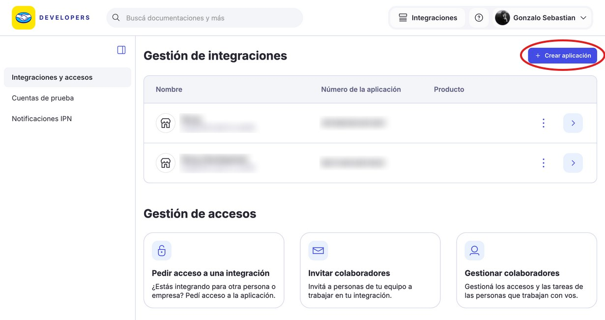
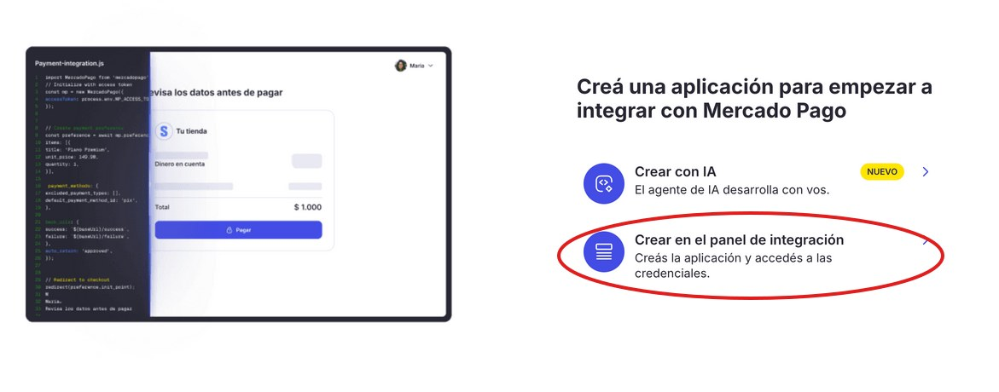
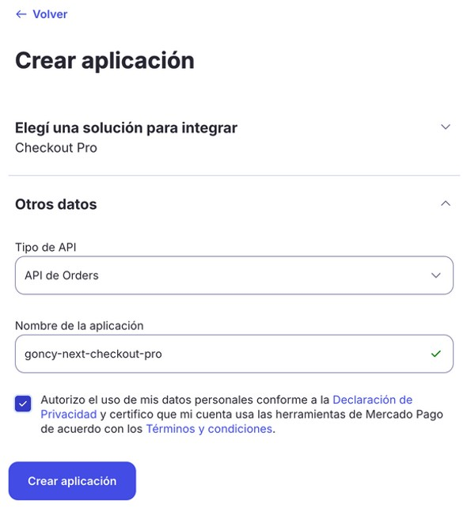

# Crear aplicación de Mercado Pago

En este documento vamos a ver como crear una aplicación en Mercado Pago para luego usar en nuestra aplicación Next.js. Cada aplicación de Mercado Pago tiene un conjunto de credenciales, configuraciones y nos permite configurar notificaciones de eventos relacionados con transacciones.

Podés hacerlo de dos formas: **a mano**, siguiendo los pasos de abajo, o **con el MCP de Mercado Pago**: [configurá el MCP](../mcp/README.md) y copiá este prompt en tu agente.

```text
Usando el MCP de Mercado Pago, creá una aplicación para pagos online en una integración propia. Producto: <Checkout Pro | Checkout Bricks | Suscripciones | Checkout API>. Nombre: next-mercadopago. Mostrame el resumen antes de crearla.
```

## A mano

Vamos a ir a [Mercado Pago Developers](https://www.mercadopago.com.ar/developers/panel/app) y tocamos `Crear aplicación`.



Elegimos `Crear en el panel de integración`.



En "Elegí una solución para integrar" vas a elegir la que quieras integrar (Checkout Bricks está dentro de `Checkout API`). Después, en `Otros datos`, le ponemos un nombre a la aplicación, aceptamos los términos y tocamos `Crear aplicación`.

> [!NOTE]
> En Checkout Pro te va a preguntar el `Tipo de API`. Elegí `API de Preferences`, que es la que usa este repositorio, aunque el panel avise que va a ser descontinuada.



Una vez creada la aplicación vamos a ser redirigidos a la pantalla de integración.

---

[Volver al inicio](../../README.md)
