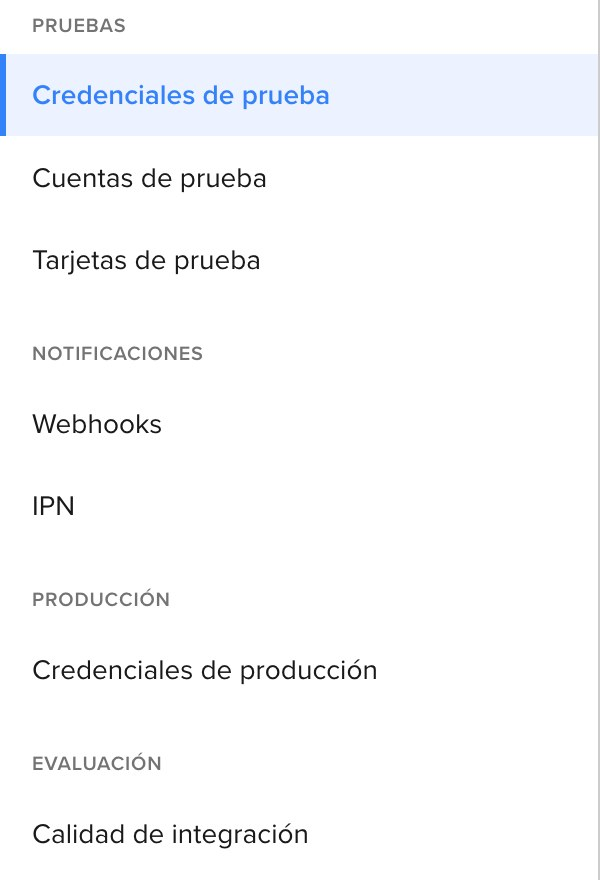
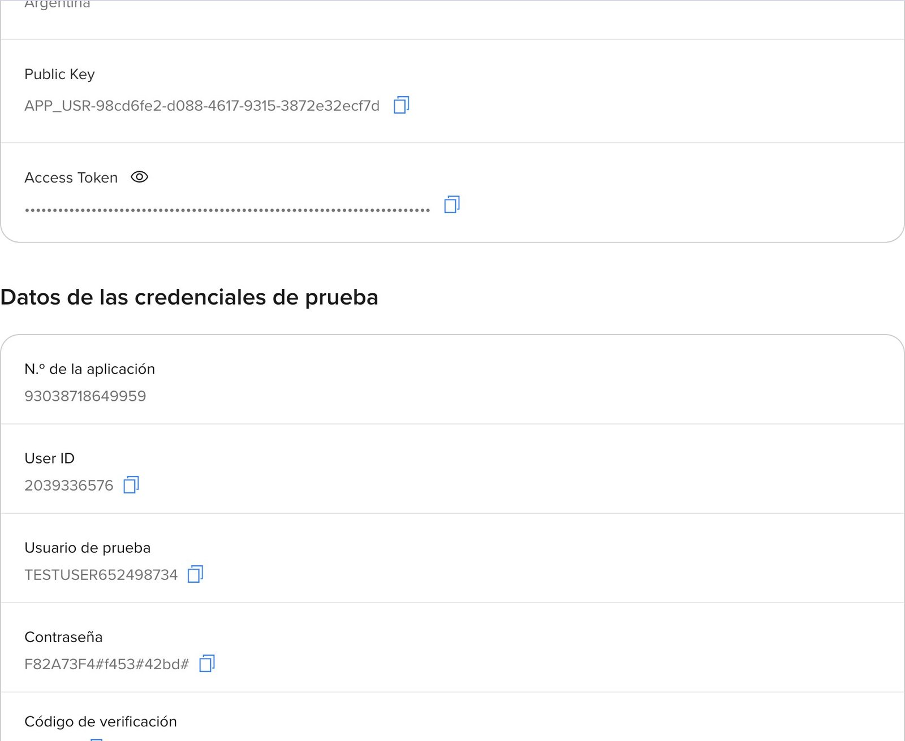

# Credenciales

Las credenciales son las claves, públicas o privadas, que vamos a usar desde nuestra aplicación Next.js para interactuar con Mercado Pago.

Las credenciales pueden ser de dos tipos:

- **Credenciales de producción**: Usamos estas credenciales para interactuar con Mercado Pago en un entorno real.
- **Credenciales de prueba**: Usamos estas credenciales para interactuar con Mercado Pago en un entorno de pruebas.

Una vez hayas ingresado a tu aplicación, vas a encontrar en el panel izquierdo los links a `Credenciales de prueba` y `Credenciales de producción`. Durante la etapa de desarrollo vamos a usar las de prueba.



Pero no todo es tan simple... En algunas integraciones, como `Checkout Bricks`, las credenciales de prueba empiezan con `TEST-` y son de tu propia aplicación.

En otras, como `Checkout Pro`, empiezan con `APP_USR-` y son de una cuenta vendedora de prueba que Mercado Pago crea sola junto con tu aplicación. Debajo de las credenciales, en `Datos de las credenciales de prueba`, vas a ver el usuario y la contraseña de esa cuenta, por si necesitás iniciar sesión con ella.



## Con el MCP de Mercado Pago

En vez de copiarlas a mano, [configurá el MCP](../mcp/README.md) y copiá este prompt en tu agente. El agente las escribe directamente en tu `.env.local`:

```text
Usando el MCP de Mercado Pago, traé las credenciales de mi aplicación (si tengo más de una, preguntame cuál usar). Copiá .env.example a .env.local y completá MP_ACCESS_TOKEN, NEXT_PUBLIC_MP_PUBLIC_KEY, NEXT_PUBLIC_MP_CLIENT_ID y MP_CLIENT_SECRET (solo las que estén en el archivo) con las credenciales de prueba. No me muestres las credenciales en el chat y no agregues el archivo a git.
```

---

[Volver al inicio](../../README.md)