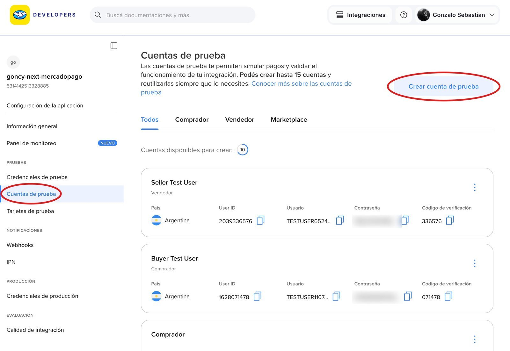
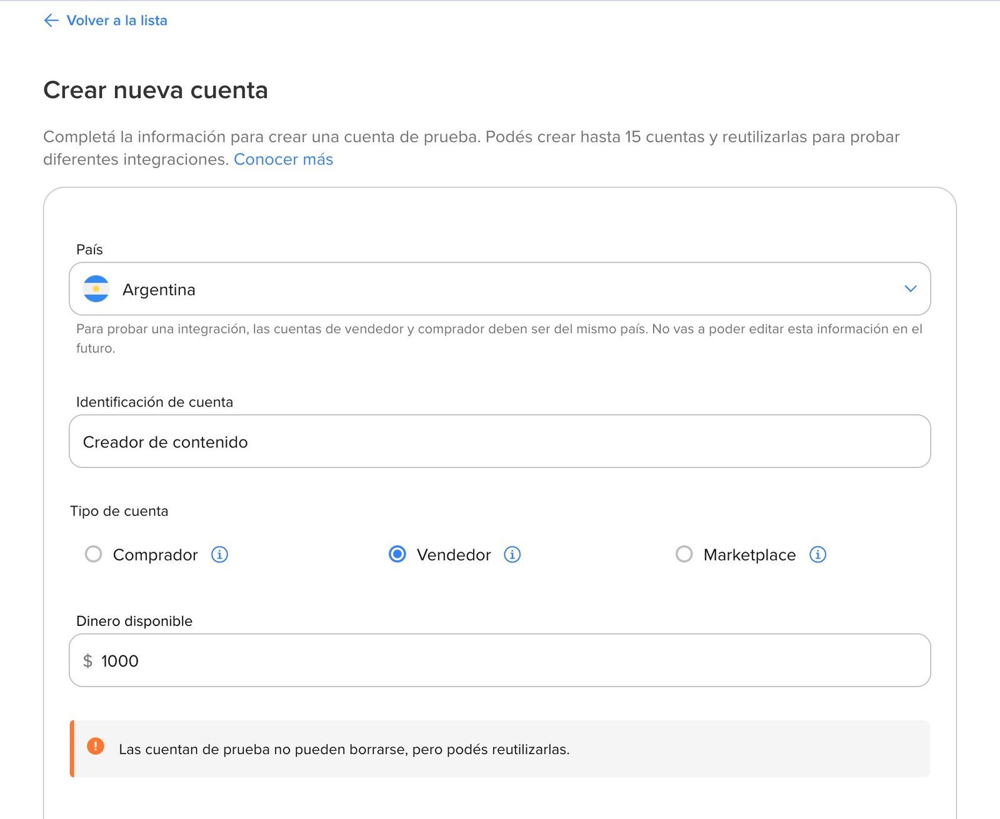
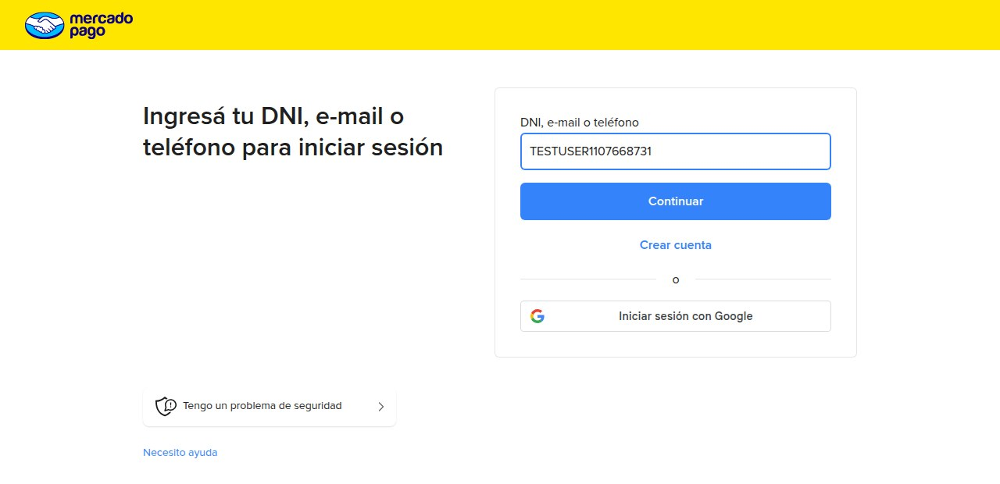
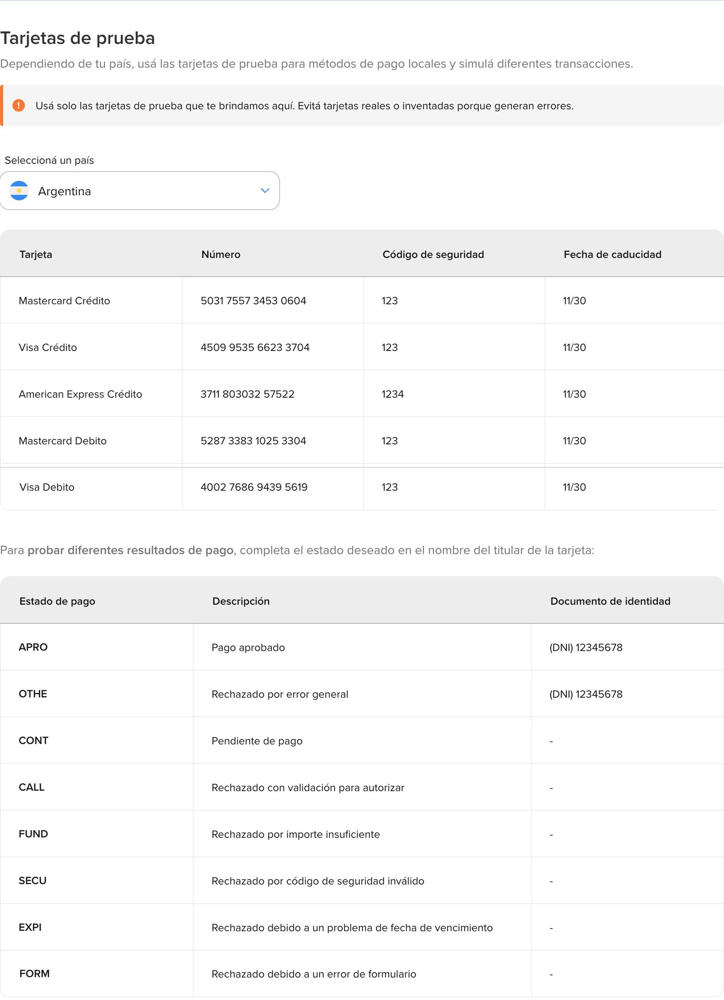

# Cuentas de prueba

Las cuentas de prueba son importantes durante el periodo de desarrollo ya que como estamos manejando dinero, las interacciones de nuestra aplicación deberían ser entre cuentas de prueba con dinero ficticio.

## Índice

- [Crear cuentas de prueba](#crear-cuentas-de-prueba)
- [Tarjetas de prueba](#tarjetas-de-prueba)

## Crear cuentas de prueba

Podés hacerlo de dos formas: **a mano**, siguiendo los pasos de abajo, o **con el MCP de Mercado Pago**: [configurá el MCP](../mcp/README.md) y copiá este prompt en tu agente.

```text
Usando el MCP de Mercado Pago, asegurate de tener una cuenta de prueba vendedora y una compradora (creálas si no existen), cargale 10000 de saldo a la compradora y mostrame el usuario de cada una.
```

El MCP no muestra las contraseñas: las encontrás en el [panel de desarrolladores](https://www.mercadopago.com.ar/developers/panel/app), en la aplicación, en `Cuentas de prueba`. Después abrí una ventana de incógnito e iniciá sesión con cada cuenta para comprobar que funcionan.

### A mano

Luego de haber [creado una aplicación](../crear-aplicacion/README.md) vamos a acceder a ella y luego vamos a ir `Cuentas de prueba` en el menú izquierdo y tocamos el botón de `Crear cuenta de prueba`.



Al crear la aplicación, Mercado Pago ya crea solo una cuenta vendedora (`Seller Test User`) y una compradora (`Buyer Test User`), así que puede que no necesites crear ninguna.

Si necesitás otra, le vamos a dar un país, un nombre, un tipo de cuenta (`Comprador`, `Vendedor` o `Marketplace`) y un monto inicial de crédito.

> [!NOTE]
> Podés tener hasta 15 cuentas de prueba y no se pueden borrar. Si llegaste al límite, reutilizá una: desde su menú (`⋮`) podés cambiarle el nombre y el tipo en `Editar datos`.

> [!TIP]
> Generalmente vas a necesitar al menos dos cuentas de prueba: una para el `Vendedor` y otra para el `Comprador`. En algunos casos, como el de `Marketplace`, vas a necesitar una tercer cuenta para representar al `Intermediario` que no es ni comprador ni vendedor.



Luego abrimos una ventana de incógnito (u otro perfil del navegador) y nos logueamos con la cuenta de prueba para asegurarnos de que la creamos correctamente. Si te pide un código por e-mail, usá el `Código de verificación` que aparece en la cuenta.



Ahora ya podemos usar la cuenta de prueba para interactuar con nuestras aplicaciones.

## Tarjetas de prueba

Con el MCP, [configurado](../mcp/README.md), podés pedirle las tarjetas a tu agente:

```text
Usando el MCP de Mercado Pago, mostrame las tarjetas de prueba de mi país y qué nombre de titular y documento usar para que el pago sea aprobado, rechazado o quede pendiente.
```

### A mano

La mayoría de las veces vamos a poder pagar con dinero en cuenta, pero si quisieramos hacer pagos de prueba con tarjetas, entramos a [nuestra aplicación](https://www.mercadopago.com.ar/developers/panel/app/) y nos vamos a `Tarjetas de prueba`.



Acá no solo vamos a encontrar un listado de tarjetas de prueba, sino que nombre y DNI deberíamos usar para cada una. Con nombres como `APRO` podemos hacer que nuestros pagos sean aceptados o podríamos usar otro como `OTHE` o `CONT` para ver como se comportaría nuestra aplicación frente a pagos rechazados o pendientes.

> [!TIP]
> En mi experiencia la tarjeta de Visa es la que mejor funciona.

---

[Volver al inicio](../../README.md)