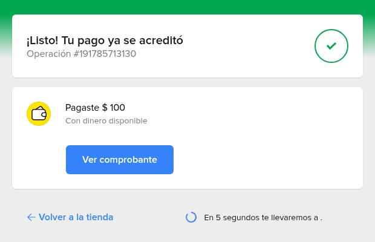

# Integración de Mercado Pago con Checkout Pro

En este documento vamos a aprender a agregar pagos a nuestra aplicación utilizando Mercado Pago Checkout Pro. Los usuarios van a poder agregar mensajes a una lista de mensajes pagando por cada mensaje.

Podés preparar todo de dos formas:

- **A mano**: asegurate de haber [clonado el proyecto](../../configuracion/clonar-aplicacion/README.md), [creado una aplicación en Mercado Pago](../../configuracion/crear-aplicacion/README.md) (para producción), haber creado dos [cuentas de prueba](../../configuracion/cuentas-de-prueba/README.md) para Comprador y Vendedor, haber iniciado sesión en otro navegador con la cuenta de prueba de Vendedor y [crear una aplicación en Mercado Pago](../../configuracion/crear-aplicacion/README.md) (para desarrollo), haber [copiado las credenciales](../../configuracion/credenciales/README.md) de producción de la aplicación del Vendedor a tu archivo `.env.example` y renombrarlo a `.env.local`, haber [expuesto el puerto 3000 al exterior](../../configuracion/exponer-puerto/README.md) y haber [configurado un webhook](../../configuracion/webhook/README.md) para escuchar eventos de `Pagos`.
- **Con el MCP**: configurá el [MCP de Mercado Pago](../../configuracion/mcp/README.md) y copiá este prompt en tu agente. Antes, [cloná el proyecto](../../configuracion/clonar-aplicacion/README.md) y [exponé el puerto 3000](../../configuracion/exponer-puerto/README.md): en el prompt, reemplazá `<URL pública>` por esa URL.

```text
Usando el MCP de Mercado Pago, prepará este proyecto para desarrollo:
1. Creá una aplicación de Checkout Pro llamada <tu usuario>-next-mercadopago-checkout-pro. Mostrame el resumen antes de crearla.
2. Cargale 10000 de saldo a la cuenta de prueba compradora que se creó con la aplicación y mostrame su usuario.
3. Copiá .env.example a .env.local. Completá MP_ACCESS_TOKEN con el access token de prueba y APP_URL con <URL pública>. No me muestres las credenciales y no agregues el archivo a git.
```

Cuando creás la aplicación, Mercado Pago también crea una cuenta de prueba vendedora y una compradora. El MCP no muestra la contraseña de la compradora: la encontrás en el [panel de desarrolladores](https://www.mercadopago.com.ar/developers/panel/app), en la aplicación, en `Cuentas de prueba`. Pagá con esa cuenta: si en el navegador tenés abierta la sesión de la vendedora, el botón de pagar queda deshabilitado porque no te podés pagar a vos mismo.

> [!NOTE]
> No hace falta configurar un webhook: cada preferencia le pasa `APP_URL` a Mercado Pago como `notification_url`. El token de prueba es de la cuenta vendedora que creó Mercado Pago, y el MCP no puede configurar webhooks en esa cuenta.

## Video

[](https://www.youtube.com/watch?v=BUHUW7tAr_Y)

## Indice

1. [Revisando nuestra aplicación](#revisando-nuestra-aplicación)
2. [Crear una preferencia de pago](#crear-una-preferencia-de-pago)
3. [Recibir notificaciones de pagos](#recibir-notificaciones-de-pagos)
4. [Verificar la autenticidad del pago](#verificar-la-autenticidad-del-pago)
5. [Listar los mensajes](#listar-los-mensajes)
6. [Probar la integración](#probar-la-integración)

## Revisando nuestra aplicación

En la página de inicio de nuestra aplicación (`/src/app/page.tsx`) se renderiza un formulario para agregar un mensaje a nuestra lista de mensajes. Al hacer submit de este formulario, se ejecuta un Server Action que obtiene una URL de Mercado Pago a la cual vamos a redirigir al usuario para que pueda pagar:

```tsx
import {redirect} from "next/navigation";

import api from "@/api";

// Queremos que esta página sea estática, nos encargaremos de revalidar los datos cuando agreguemos un nuevo mensaje
export const ensureStatic = "navigation";

export default async function HomePage() {
  const messages = await api.message.list();

  async function add(formData: FormData) {
    "use server";

    const message = formData.get("text") as string;
    const url = await api.message.submit(message);

    redirect(url);
  }

  return (
    <section className="grid gap-8">
      <form action={add} className="grid gap-2">
        <textarea
          className="border-2 border-blue-400 p-2"
          name="text"
          placeholder="Hola perro"
          rows={3}
        />
        <button className="rounded bg-blue-400 p-2" type="submit">
          Enviar
        </button>
      </form>
      <ul className="grid gap-2">
        {messages.map((message) => (
          <li key={message.id} className="rounded bg-blue-400/10 p-4">
            {message.text}
          </li>
        ))}
      </ul>
    </section>
  );
}
```

## Crear una preferencia de pago

Dentro de `/src/api.ts`, la función `submit` en `message` se encarga de crear una preferencia de pago y devolver el init point (url de pago):

```ts
const api = {
  message: {
    async submit(text: Message["text"]) {
      // Creamos la preferencia incluyendo el precio, titulo y metadata. La información de `items` es standard de Mercado Pago. La información que nosotros necesitamos para nuestra DB debería vivir en `metadata`.
      const preference = await new Preference(mercadopago).create({
        body: {
          items: [
            {
              id: "message",
              unit_price: 100,
              quantity: 1,
              title: "Mensaje de muro",
            },
          ],
          metadata: {
            text,
          },
          // Marcamos el pago como mensaje para poder buscarlo después
          external_reference: "message",
          // Le pedimos a Mercado Pago que nos notifique los cambios del pago en nuestro webhook
          notification_url: `${process.env.APP_URL}/api/mercadopago`,
          // Cuando el pago se aprueba, Mercado Pago vuelve solo a nuestra aplicación
          back_urls: {
            success: process.env.APP_URL,
          },
          auto_return: "approved",
        },
      });

      // Devolvemos el init point (url de pago) para que el usuario pueda pagar
      return preference.init_point!;
    }
  }
}
```

Podemos pensar a la preferencia de pago como un objeto que representa una orden de compra. algo que un usuario quiere comprar.

Con `notification_url` cada preferencia le dice a Mercado Pago a dónde notificar sus pagos, usando la URL pública que guardamos en `APP_URL`. Así las notificaciones llegan aunque las credenciales sean de una cuenta de prueba que no configuramos nosotros.

Con `auto_return: "approved"` Mercado Pago vuelve solo a nuestra aplicación cuando el pago se aprueba. Para eso necesita saber a dónde volver, así que también definimos `back_urls.success`.

Hay varias propiedades más que podemos agregar a la preferencia de pago. Una descripción más extensa del producto, etc. Podés ver más [acá](https://www.mercadopago.com.ar/developers/es/reference/preferences/_checkout_preferences/post).

## Recibir notificaciones

Tenemos un Route Handler (`src/app/api/mercadopago/route.ts`) definido en nuestra aplicación que se encarga de recibir las notificaciones de Mercado Pago.

```ts
import {Payment} from "mercadopago";
import {revalidateTag} from "next/cache";

import {mercadopago} from "@/api";

export async function POST(request: Request) {
  // Obtenemos el cuerpo de la petición que incluye información sobre la notificación
  const body: {data?: {id: string}; type?: string} = await request.json();

  // Solo nos interesan las notificaciones de pagos, ignoramos el resto (como las de `merchant_order`)
  if (body.type !== "payment" || !body.data?.id) {
    return new Response(null, {status: 200});
  }

  // Obtenemos el pago
  const payment = await new Payment(mercadopago).get({id: body.data.id});

  // Si se aprueba, invalidamos los mensajes para mostrar el nuevo pago
  if (payment.status === "approved") {
    revalidateTag("messages", {expire: 0});
  }

  // Respondemos con un estado 200 para indicarle que la notificación fue recibida
  return new Response(null, {status: 200});
}
```

> [!NOTE]
> Es importante siempre retornar un estado 200 para indicarle a Mercado Pago que la notificación fue recibida. Solo debemos retornar un estado que no sea 200 cuando hubo algún error por el cual queremos que Mercado Pago nos notifique nuevamente.

## Verificar la autenticidad del pago

Este Route Handler va a recibir las notificaciones de pago de Mercado Pago, va a obtener el pago usando el ID que nos llega en la notificación. En caso de que el pago sea aprobado, va a invalidar el tag `messages` para que se muestren los mensajes actualizados.

> [!NOTE]
> La página es estática (`ensureStatic = "navigation"` hace que el build falle si algo la vuelve dinámica). `api.message.list` usa `"use cache"` con el tag `messages`. Como la notificación llega a un Route Handler usamos `revalidateTag` con `{expire: 0}` para que la próxima visita ya vea el mensaje nuevo.

De esta manera nos aseguramos de que el pago exista y haya sido aprobado.

## Listar los mensajes

No tenemos una base de datos: Mercado Pago ya guarda cada pago con el texto en su `metadata`. Dentro de `/src/api.ts`, la función `list` en `message` busca los pagos aprobados marcados como mensaje (por eso usamos `external_reference: "message"` en la preferencia) y los devuelve como mensajes:

```ts
const api = {
  message: {
    async list(): Promise<Message[]> {
      // Cacheamos los mensajes hasta que los invalidemos con el tag "messages"
      "use cache";

      cacheLife("max");
      cacheTag("messages");

      // Mercado Pago es nuestra base de datos: cada mensaje es un pago aprobado con el texto en su `metadata`
      const {results = []} = await new Payment(mercadopago).search({
        options: {external_reference: "message", status: "approved"},
      });

      // Devolvemos los pagos como mensajes
      return results.map((payment) => ({id: payment.id!, text: payment.metadata.text}));
    },
  },
};
```

Como cada mensaje es un pago, tampoco se pueden duplicar: aunque Mercado Pago nos notifique varias veces el mismo pago, la búsqueda lo devuelve una sola vez.

En una aplicación real deberíamos verificar la concordancia de la clave secreta, devolver errores más descriptivos y más, pero por simplicidad y tiempo te voy a dejar esa tarea a vos, podés ver más [acá](https://www.mercadopago.com.ar/developers/es/docs/your-integrations/notifications/webhooks#configuracinatravsdetusintegraciones).

## Probar la integración

Ahora vamos a intentar de hacer el flujo completo de agregar un mensaje a nuestra lista de mensajes y veamos si funciona.



Excelente, nuestro pago fue aprobado, la notificación fue recibida y nuestro mensaje aparece en la lista ✨.

---

[Volver al inicio](../../README.md)
