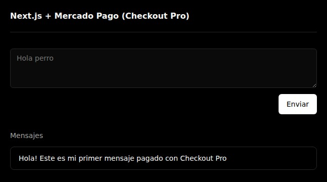

# Integración de Mercado Pago con Checkout Pro

En este documento vamos a aprender a agregar pagos a nuestra aplicación utilizando Mercado Pago Checkout Pro. Los usuarios van a poder agregar mensajes a una lista de mensajes pagando por cada mensaje.

Podés preparar todo de dos formas:

- **A mano**: asegurate de haber [clonado el proyecto](../../configuracion/clonar-aplicacion/README.md), [creado una aplicación de Checkout Pro en Mercado Pago](../../configuracion/crear-aplicacion/README.md), haber [copiado las credenciales de prueba](../../configuracion/credenciales/README.md) a tu archivo `.env.example` y renombrarlo a `.env.local` y haber [expuesto el puerto 3000 al exterior](../../configuracion/exponer-puerto/README.md). Para pagar vas a usar una [tarjeta de prueba](../../configuracion/cuentas-de-prueba/README.md#tarjetas-de-prueba) y el e-mail de la cuenta de prueba compradora que Mercado Pago crea junto con la aplicación.
- **Con el MCP**: configurá el [MCP de Mercado Pago](../../configuracion/mcp/README.md) con tu cuenta principal y copiá este prompt en tu agente. Antes, [cloná el proyecto](../../configuracion/clonar-aplicacion/README.md) y [exponé el puerto 3000](../../configuracion/exponer-puerto/README.md): en el prompt, reemplazá `<URL pública>` por esa URL.

```text
Usando el MCP de Mercado Pago, prepará este proyecto para desarrollo:
1. Creá una aplicación de Checkout Pro llamada <tu usuario>-next-mercadopago-checkout-pro. Mostrame el resumen antes de crearla.
2. Mostrame el usuario de la cuenta de prueba compradora que se creó con la aplicación.
3. Copiá .env.example a .env.local. Completá MP_ACCESS_TOKEN con el access token de prueba y APP_URL con <URL pública>. No me muestres las credenciales y no agregues el archivo a git.
```

El usuario de la compradora también está en el [panel de desarrolladores](https://www.mercadopago.com.ar/developers/panel/app), en la aplicación, en `Cuentas de prueba`. Lo vas a necesitar para [probar la integración](#probar-la-integración).

## Video

[](https://www.youtube.com/watch?v=BUHUW7tAr_Y)

> [!NOTE]
> El video usa la API de Preferences, que Mercado Pago va a dar de baja. Este documento ya usa la API de Orders, así que el código cambia un poco, pero el flujo es el mismo.

## Índice

1. [Revisando nuestra aplicación](#revisando-nuestra-aplicación)
2. [Crear una order de pago](#crear-una-order-de-pago)
3. [Volver a la aplicación y recibir notificaciones](#volver-a-la-aplicación-y-recibir-notificaciones)
4. [Verificar la autenticidad del pago](#verificar-la-autenticidad-del-pago)
5. [Listar los mensajes](#listar-los-mensajes)
6. [Probar la integración](#probar-la-integración)

## Revisando nuestra aplicación

En la página de inicio de nuestra aplicación (`/src/app/page.tsx`) se renderiza un formulario para agregar un mensaje a nuestra lista de mensajes. Al hacer submit de este formulario, se ejecuta un Server Action que obtiene una URL de Mercado Pago a la cual vamos a redirigir al usuario para que pueda pagar:

```tsx
import {redirect} from "next/navigation";

import api from "@/api";

// Queremos que esta página sea estática, nos encargaremos de revalidar los datos cuando agreguemos un nuevo mensaje
export const ensureStatic = "navigation";

export default async function HomePage() {
  const messages = await api.message.list();

  async function add(formData: FormData) {
    "use server";

    const message = formData.get("text") as string;
    const url = await api.message.submit(message);

    redirect(url);
  }

  return (
    <section className="grid gap-8">
      <form action={add}>
        <textarea maxLength={150} name="text" placeholder="Hola perro" rows={3} />
        <button type="submit">Enviar</button>
      </form>
      <section className="grid gap-3">
        <h2>Mensajes</h2>
        <ul>
          {messages.map((message) => (
            <li key={message.id}>{message.text}</li>
          ))}
        </ul>
      </section>
    </section>
  );
}
```

## Crear una order de pago

Dentro de `/src/api.ts`, la función `submit` en `message` se encarga de crear una order de pago y devolver el checkout url (url de pago):

```ts
const api = {
  message: {
    async submit(text: Message["text"]) {
      // Creamos la order incluyendo el monto, los items y la descripción. La información de `items` es standard de Mercado Pago. Orders no tiene `metadata`, así que guardamos el texto del mensaje en `description`.
      const order = await new Order(mercadopago).create({
        body: {
          // Checkout Pro usa orders `online` procesadas en modo `manual`: el comprador paga en Mercado Pago
          type: "online",
          processing_mode: "manual",
          // Los montos de Orders son strings
          total_amount: "100.00",
          items: [
            {
              external_code: "message",
              unit_price: "100.00",
              quantity: 1,
              title: "Mensaje de muro",
            },
          ],
          description: text,
          // Marcamos la order como mensaje para poder buscarla después
          external_reference: "message",
          config: {
            online: {
              // Cuando el pago se aprueba, Mercado Pago vuelve solo a nuestra aplicación, a la ruta que verifica la order
              success_url: `${process.env.APP_URL}/api/mercadopago`,
              auto_return: "approved",
            },
          },
        },
      });

      // Devolvemos la url del checkout para que el usuario pueda pagar
      return order.checkout_url!;
    }
  }
}
```

Podemos pensar a la order como un objeto que representa una orden de compra: algo que un usuario quiere comprar. Para Checkout Pro siempre es `type: "online"` con `processing_mode: "manual"`, y `total_amount` tiene que ser igual a la suma de los items.

Orders no tiene un campo `metadata` como tenían las preferencias, así que guardamos el texto del mensaje en `description`. `description` acepta hasta 150 caracteres, por eso el `textarea` del formulario tiene `maxLength={150}`.

Con `auto_return: "approved"` Mercado Pago vuelve solo a nuestra aplicación cuando el pago se aprueba. Para eso necesita saber a dónde volver, así que también definimos `success_url`.

Hay varias propiedades más que podemos agregar a la order. Datos del comprador, el vencimiento, los medios de pago permitidos, etc. Podés ver más [acá](https://www.mercadopago.com.ar/developers/es/reference/online-payments/checkout-pro/create-order/post).

## Volver a la aplicación y recibir notificaciones

Tenemos un Route Handler (`src/app/api/mercadopago/route.ts`) definido en nuestra aplicación que se encarga de dos cosas: recibir al comprador cuando vuelve de Mercado Pago (`GET`) y recibir las notificaciones del webhook (`POST`).

```ts
import {Order} from "mercadopago";
import {revalidateTag} from "next/cache";
import {type NextRequest, NextResponse} from "next/server";

import {mercadopago} from "@/api";

async function verify(id: string) {
  // Obtenemos la order desde Mercado Pago para no confiar en lo que nos llega en la petición
  const order = await new Order(mercadopago).get({id});

  // Si se procesó (el pago se aprobó), invalidamos los mensajes para mostrar el nuevo mensaje
  if (order.status === "processed") {
    revalidateTag("messages", {expire: 0});
  }
}

// Mercado Pago redirige al comprador acá cuando el pago se aprueba, con el id de la order en `order_id`
export async function GET(request: NextRequest) {
  const id = request.nextUrl.searchParams.get("order_id");

  if (id) {
    await verify(id);
  }

  // Volvemos a la página de inicio, que ya muestra el mensaje nuevo
  return NextResponse.redirect(process.env.APP_URL!);
}

// Mercado Pago nos envía acá las notificaciones del webhook que configuramos en el panel
export async function POST(request: Request) {
  // Obtenemos el cuerpo de la petición que incluye información sobre la notificación
  const body: {data?: {id: string}; type?: string} = await request.json();

  // Solo nos interesan las notificaciones de orders, ignoramos el resto
  if (body.type === "order" && body.data?.id) {
    await verify(body.data.id);
  }

  // Respondemos con un estado 200 para indicarle que la notificación fue recibida
  return new Response(null, {status: 200});
}
```

Cuando el pago se aprueba, Mercado Pago redirige al comprador a `success_url` y le agrega a la URL el id de la order en `order_id`. Es lo primero que pasa después de pagar, así que el mensaje ya aparece cuando el comprador vuelve a la página de inicio.

Pero si el comprador cierra la pestaña antes de volver, nunca nos enteramos. Para eso está el webhook: Mercado Pago le avisa a nuestro servidor de cada cambio en la order, aunque el comprador no vuelva. Con Orders, el webhook se [configura en el panel](../../configuracion/webhook/README.md) con el evento `Order (Mercado Pago)` y la URL `<APP_URL>/api/mercadopago`.

> [!IMPORTANT]
> Las notificaciones llegan a la aplicación dueña de las credenciales con las que creamos la order. Con las credenciales de prueba de Checkout Pro, que son de la cuenta vendedora que Mercado Pago crea sola, no pudimos hacer que llegaran: esa cuenta tiene su propia aplicación y no la podemos configurar. Por eso, mientras desarrollamos, el mensaje aparece gracias a la vuelta del comprador. Con tus credenciales de producción, el webhook de tu aplicación sí recibe las notificaciones.

> [!NOTE]
> Es importante siempre retornar un estado 200 para indicarle a Mercado Pago que la notificación fue recibida. Solo debemos retornar un estado que no sea 200 cuando hubo algún error por el cual queremos que Mercado Pago nos notifique nuevamente.

## Verificar la autenticidad del pago

Tanto la vuelta del comprador como el webhook nos dan el ID de una order, pero cualquiera podría visitar esa URL o hacer un POST con un ID inventado. Por eso no confiamos en lo que nos llega: `verify` obtiene la order desde Mercado Pago con nuestras credenciales y solo si su `status` es `processed` (el pago se aprobó y se acreditó) invalida el tag `messages` para que se muestren los mensajes actualizados.

> [!NOTE]
> La página es estática (`ensureStatic = "navigation"` hace que el build falle si algo la vuelve dinámica). `api.message.list` usa `"use cache"` con el tag `messages`. Como la verificación pasa en un Route Handler usamos `revalidateTag` con `{expire: 0}` para que la próxima visita ya vea el mensaje nuevo.

De esta manera nos aseguramos de que la order exista y haya sido pagada.

## Listar los mensajes

No tenemos una base de datos: Mercado Pago ya guarda cada order con el texto en su `description`. Dentro de `/src/api.ts`, la función `list` en `message` busca las orders procesadas marcadas como mensaje (por eso usamos `external_reference: "message"` en la order) y las devuelve como mensajes:

```ts
const api = {
  message: {
    async list(): Promise<Message[]> {
      // Cacheamos los mensajes hasta que los invalidemos con el tag "messages"
      "use cache";

      cacheLife("max");
      cacheTag("messages");

      // La búsqueda de orders acepta un rango de fechas de hasta un mes, así que buscamos las de los últimos 30 días
      const end = new Date();
      const begin = new Date(end.getTime() - 30 * 24 * 60 * 60 * 1000);

      // Mercado Pago es nuestra base de datos: cada mensaje es una order procesada (pagada) con el texto en su `description`
      const {data = []} = await new Order(mercadopago).search({
        options: {
          external_reference: "message",
          status: "processed",
          begin_date: begin.toISOString(),
          end_date: end.toISOString(),
        },
      });

      // Devolvemos las orders como mensajes
      return data.map((order) => ({id: order.id!, text: order.description!}));
    },
  },
};
```

La búsqueda de orders pide un rango de fechas (`begin_date` y `end_date`) de hasta un mes, así que el muro muestra los mensajes de los últimos 30 días. Como `list` está cacheada, las fechas se calculan cada vez que invalidamos el tag `messages`, no en cada visita.

Como cada mensaje es una order, tampoco se pueden duplicar: aunque Mercado Pago nos notifique varias veces la misma order, la búsqueda la devuelve una sola vez.

En una aplicación real deberíamos verificar la firma secreta de las notificaciones, devolver errores más descriptivos y más, pero por simplicidad y tiempo te voy a dejar esa tarea a vos, podés ver más [acá](https://www.mercadopago.com.ar/developers/es/docs/checkout-pro-orders/notifications).

## Probar la integración

Ahora vamos a intentar de hacer el flujo completo de agregar un mensaje a nuestra lista de mensajes y veamos si funciona. Abrí la aplicación en una ventana de incógnito, agregá un mensaje y pagá con `Tarjeta` usando una [tarjeta de prueba](../../configuracion/cuentas-de-prueba/README.md#tarjetas-de-prueba): como titular poné `APRO` (con DNI `12345678`) para que el pago se apruebe.

En `E-mail para comprobante` poné el e-mail de la cuenta compradora de prueba. Si su usuario es `TESTUSER123456`, su e-mail es `test_user_123456@testuser.com`. Con cualquier otro e-mail Mercado Pago rechaza el pago con "Una de las partes con la que intentás hacer el pago es de prueba", porque la vendedora es de prueba y el comprador no.

Cuando el pago se aprueba, Mercado Pago nos devuelve solo a la aplicación, que verifica la order y ya muestra el mensaje.



Excelente, nuestro pago fue aprobado, la order fue verificada y nuestro mensaje aparece en la lista ✨.

---

[Volver al inicio](../../README.md)
