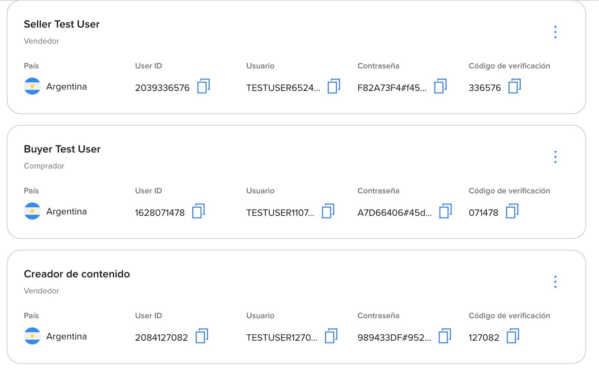
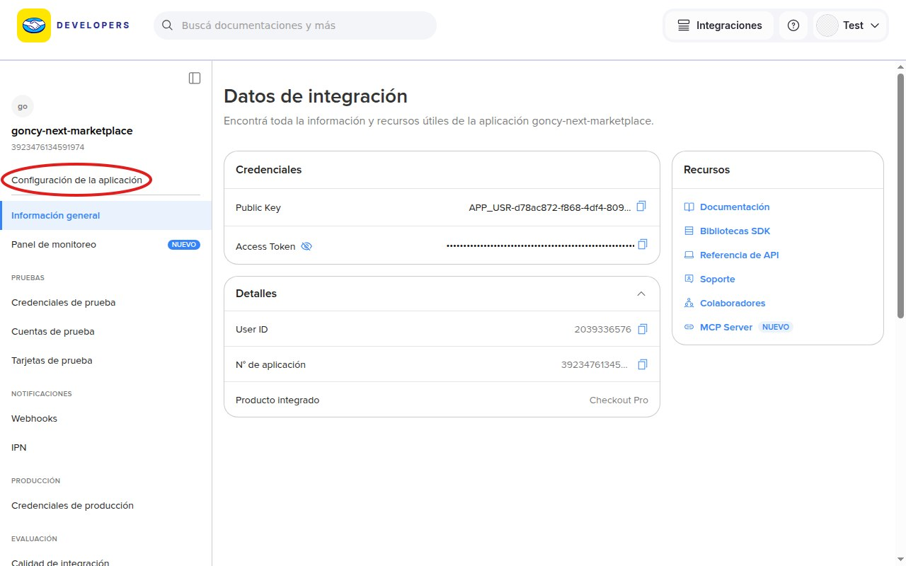
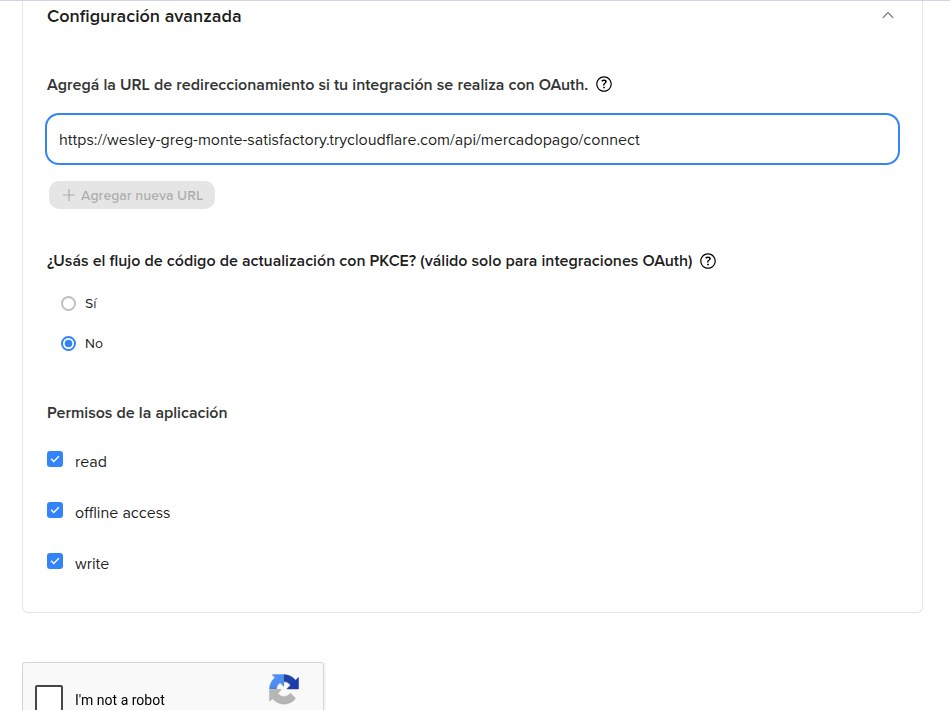
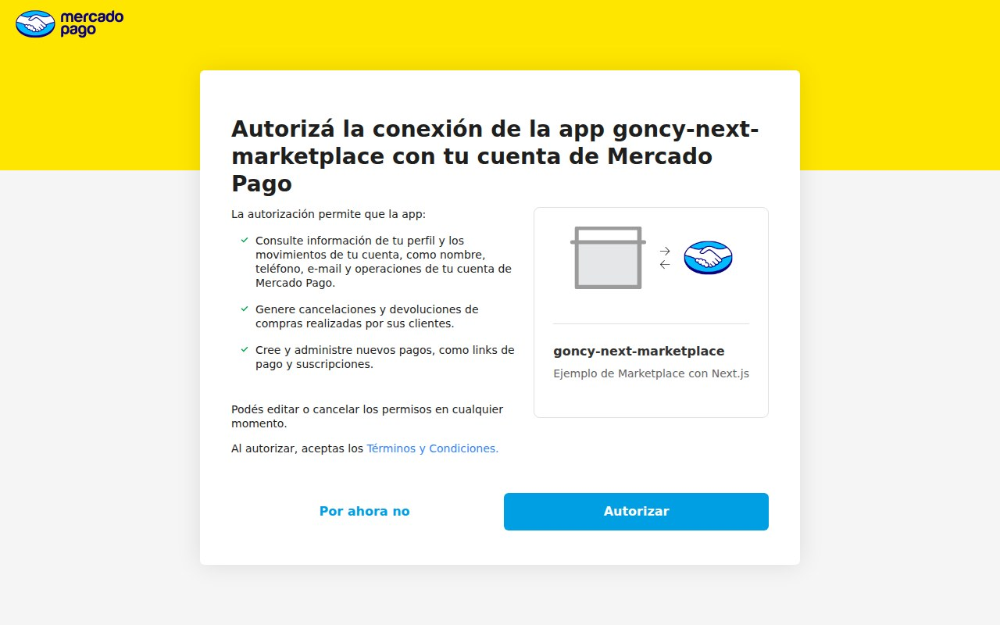
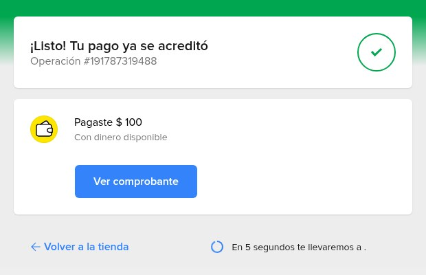
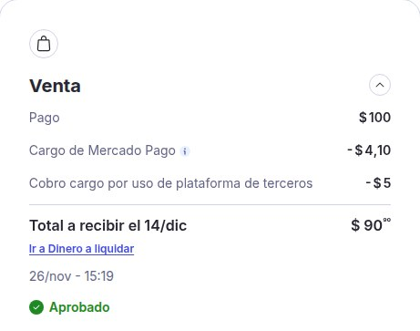

# Integración de Mercado Pago con Checkout Pro y Split de pagos (Marketplace)

En este documento vamos a aprender a agregar pagos a nuestra aplicación utilizando Mercado Pago Checkout Pro con la funcionalidad de Marketplace. Los usuarios van a poder agregar mensajes a una lista de mensajes pagando por cada mensaje y el intermediario (Marketplace) se queda con una parte de la venta.

Un caso de uso para esta implementación sería una plataforma como [Cafecito](https://cafecito.app/). Donde hay creadores de contenido (Vendedor), un comprador para ese contenido (Comprador) y la plataforma que se queda con una parte por el valor agregado (Marketplace).

La implementación de esta funcionalidad es muy similar a la integracion con Checkout Pro, así que para poder seguir, primero completá todos los pasos de la [Integración de Mercado Pago con Checkout Pro](../checkout-pro/README.md).

Podés preparar todo de dos formas:

- **A mano**: siguiendo todos los pasos de abajo.
- **Con el MCP**: configurá el [MCP de Mercado Pago](../../configuracion/mcp/README.md) con los dos servidores, [cloná el proyecto](../../configuracion/clonar-aplicacion/README.md), [exponé el puerto 3000](../../configuracion/exponer-puerto/README.md) y copiá este prompt en tu agente. En el prompt, reemplazá `<URL pública>` por esa URL.

```text
Usando el MCP de Mercado Pago, prepará este proyecto para desarrollo:
1. Con mercadopago-mcp-principal, asegurate de tener una cuenta de prueba vendedora y una compradora (creálas si no existen), cargale 10000 de saldo a la compradora y mostrame su usuario.
2. Con mercadopago-mcp-vendedor, creá una aplicación de Checkout Pro llamada <tu usuario>-next-marketplace con la URL de redirección <URL pública>/api/mercadopago/connect. Mostrame el resumen antes de crearla. Si mercadopago-mcp-vendedor no está autorizado, pedime que lo autorice con la cuenta vendedora de prueba y esperá. Si la respuesta dice que la URL de redirección no se aplicó, pasame el link https://www.mercadopago.com.ar/developers/panel/app/<App ID>/edit-app y la URL que tengo que pegar en `Configuración avanzada`, y esperá a que te avise que la guardé.
3. Con mercadopago-mcp-vendedor, configurá el webhook de esa aplicación en <URL pública>/api/mercadopago, en producción y en prueba, para el evento Order (Mercado Pago).
4. Copiá .env.example a .env.local. Completá MP_ACCESS_TOKEN con el access token de producción de esa aplicación, NEXT_PUBLIC_MP_CLIENT_ID y MP_CLIENT_SECRET con su Client ID y su Client Secret, y APP_URL con <URL pública>. No me muestres las credenciales y no agregues el archivo a git.
```

La cuenta vendedora de prueba hace de Marketplace: es la dueña de la aplicación. El MCP no puede configurar la URL de redirección ni crear una segunda cuenta vendedora, así que [crear la cuenta del creador de contenido](#crear-una-cuenta-de-prueba-extra-para-marketplace) y [configurar la URL de redirección](#configurando-la-url-de-redirección) los hacés a mano en el panel, también si usaste el MCP. Después seguí desde [Revisando nuestra aplicación](#revisando-nuestra-aplicación).

Para probar vas a usar tres sesiones distintas: el creador de contenido para conectar su cuenta, la compradora para pagar y la vendedora de prueba (Marketplace) solo para el panel. Si en el navegador tenés abierta otra sesión, cerrala antes de conectar o de pagar.

## Índice

1. [Crear una cuenta de prueba extra para Marketplace](#crear-una-cuenta-de-prueba-extra-para-marketplace)
2. [Configurando la URL de redirección](#configurando-la-url-de-redirección)
3. [Revisando nuestra aplicación](#revisando-nuestra-aplicación)
4. [Obtener la URL de autorización](#obtener-la-url-de-autorización)
5. [Autorizar la integración](#autorizar-la-integración)
6. [Guardar el access token autorizado](#guardar-el-access-token-autorizado)
7. [Crear una order de pago en nombre del creador de contenido](#crear-una-order-de-pago-en-nombre-del-creador-de-contenido)
8. [Volver a la aplicación y recibir notificaciones](#volver-a-la-aplicación-y-recibir-notificaciones)
9. [Listar los mensajes del creador de contenido](#listar-los-mensajes-del-creador-de-contenido)
10. [Probar la integración](#probar-la-integración)

## Crear una cuenta de prueba extra para Marketplace

Como en este proceso hay 3 partes (Comprador, Vendedor y Marketplace), necesitamos una cuenta de prueba más. Ya teníamos la vendedora (`Seller Test User`), que hace de Marketplace porque es la dueña de la aplicación, y la compradora (`Buyer Test User`). Desde tu cuenta principal, en `Cuentas de prueba`, creá una cuenta nueva de tipo `Vendedor` llamada `Creador de contenido`.



## Configurando la URL de redirección

En este proceso vamos a hacer que el usario "Creador de contenido" autorice al usuario "Marketplace" a crear orders de pago en su nombre. Esto se hace mediante OAuth, donde luego de que el usuario "Creador de contenido" autorice la integración, se lo redirigirá a una URL de nuestra aplicación, la cual debemos configurar en Mercado Pago.

En Mercado Pago, dentro del panel de administración de nuestra aplicación en nuestra cuenta de `Marketplace`, vamos a `Configuración de la aplicación` en el menú izquierdo. Iniciá sesión con la cuenta vendedora de prueba (en una ventana de incógnito, si tenés abierta tu cuenta principal) y entrá directo a `https://www.mercadopago.com.ar/developers/panel/app/<App ID>/edit-app`.

> [!NOTE]
> `create_application` del MCP recibe la URL de redirección, pero hoy no la aplica: responde `Redirect URL Not Applied` y deja `https://www.mercadopago.com`. Por eso este paso siempre es a mano.



Abrimos `Configuración avanzada` y en la URL de redireccionamiento vamos a poner la URL de nuestra aplicación (la que tenemos en `APP_URL` en nuestro archivo `.env.local`) y le agregamos `/api/mercadopago/connect` al final. Vamos a ver que hace esa ruta más adelante. Marcamos el captcha y tocamos `Guardar cambios`.



> [!NOTE]
> Si no se guarda, revisá los errores en `Datos básicos`: el panel no acepta nombres que se parecen a una marca registrada (como los que incluyen `mercadopago`) y pide una descripción.

## Revisando nuestra aplicación

En la página de inicio de nuestra aplicación (`/src/app/page.tsx`) leemos el access token del creador de contenido desde una cookie. Si ya autorizó la integración, se renderiza el formulario para agregar un mensaje y la lista de mensajes, de la misma manera que lo hacemos en la integración de Checkout Pro. Sino, se renderiza un link que nos redirige a Mercado Pago para que autorice la integración:

```tsx
import {redirect} from "next/navigation";

import api from "@/api";

export default async function MarketplacePage() {
  // Obtenemos el access token del vendedor
  const marketplace = await api.user.token();

  // Si no autorizó la integración, mostramos un botón para redirigirlo a Mercado Pago a autorizar
  if (!marketplace) {
    const authorizationUrl = await api.user.authorize();

    return <a href={authorizationUrl}>Conectar Mercado Pago</a>;
  }

  // Obtenemos los mensajes del vendedor
  const messages = await api.message.list(marketplace);

  // Creamos una order de pago y redirigimos al usuario a Mercado Pago
  async function add(formData: FormData) {
    "use server";

    const message = formData.get("text") as string;
    // Leemos el access token en el servidor para no exponerlo en el formulario
    const marketplace = await api.user.token();
    const url = await api.message.submit(message, marketplace!);

    redirect(url);
  }

  return (
    <section className="grid gap-8">
      <form action={add}>
        <textarea maxLength={150} name="text" placeholder="Hola perro" rows={3} />
        <button type="submit">Enviar</button>
      </form>
      <section className="grid gap-3">
        <h2>Mensajes</h2>
        <ul>
          {messages.map((message) => (
            <li key={message.id}>{message.text}</li>
          ))}
        </ul>
      </section>
    </section>
  );
}
```

> [!NOTE]
> Como leemos una cookie, la página se renderiza en cada request. El archivo `loading.tsx` la envuelve en un `<Suspense>` y muestra "Cargando..." mientras tanto, y el resto (el layout y ese fallback) sigue siendo estático.

## Obtener la URL de autorización

Dentro de `/src/api.ts`, la función `authorize` en `user` se encarga de generar la URL a donde vamos a redirigir al usuario para que autorice al Marketplace a crear orders de pago en su nombre:

```ts
const api = {
  user: {
    async authorize() {
      // Obtenemos la url de autorización
      const url = new OAuth(mercadopago).getAuthorizationURL({
        options: {
          client_id: process.env.NEXT_PUBLIC_MP_CLIENT_ID,
          redirect_uri: `${process.env.APP_URL}/api/mercadopago/connect`,
        },
      });

      // Devolvemos la url
      return url;
    },
  }
}
```

> [!IMPORTANT]
> Para esta integración necesitamos que `NEXT_PUBLIC_MP_CLIENT_ID` esté definido en nuestro archivo `.env.local`. Recordá tomarlo desde la aplicación que creaste desde tu cuenta Marketplace.

## Autorizar la integración

Si vamos a nuestra aplicación, vamos a ver un botón que dice `Conectar Mercado Pago`. Asegurate de clickear ese link mientras estás logueado como `Creador de contenido`. Esto nos va a redirigir a Mercado Pago donde nos va a preguntar a que país correspondemos y luego vas a ver una pantalla como esta:



Tocamos `Autorizar` y vamos a ser redirigidos a nuestra aplicación, donde vamos a ver el formulario para agregar un mensaje.

## Guardar el access token autorizado

Una vez que el usuario fue autorizado, es redirigido a nuestra aplicación hacia la ruta `/api/mercadopago/connect` junto con un parámetro `code` en la URL:

```ts
import {NextRequest, NextResponse} from "next/server";

import api from "@/api";

export async function GET(request: NextRequest) {
  // Obtenemos el code de la request
  const code = request.nextUrl.searchParams.get("code");

  // Conectamos al usuario con el code y guardamos su access token en una cookie
  await api.user.connect(code!);

  // Redirigimos al usuario a la página del marketplace
  return NextResponse.redirect(process.env.APP_URL!);
}
```

Vamos a extraer ese parametro y se lo pasamos a la función `connect` en `user` para obtener las credenciales del usuario, incluyendo un access token que nos permite crear orders de pago en nombre del creador de contenido.

Ese access token lo guardamos en una cookie `httpOnly` (que solo puede leer el servidor) y redirigimos al usuario nuevamente a la página de inicio.

> [!NOTE]
> Las credenciales incluyen más información, como un refresh token, cuando vence y más. En una aplicación real deberíamos guardar ambos e intercambiar el refresh token por un nuevo access token cuando este expire. Pero esa tarea te la dejo a vos.

Dentro de `/src/api.ts`, la función `connect` en `user` se encarga de intercambiar el code por esas credenciales y guardar el access token en la cookie. La función `token` la lee cuando la necesitamos:

```ts
const api = {
  user: {
    async token() {
      // Leemos el access token del vendedor de la cookie que guardamos al conectar su cuenta
      const cookieStore = await cookies();

      return cookieStore.get("marketplace")?.value;
    },
    async connect(code: string) {
      // Obtenemos las credenciales del usuario usando el code que obtuvimos de oauth
      const credentials = await new OAuth(mercadopago).create({
        body: {
          client_id: process.env.NEXT_PUBLIC_MP_CLIENT_ID,
          client_secret: process.env.MP_CLIENT_SECRET,
          code,
          redirect_uri: `${process.env.APP_URL}/api/mercadopago/connect`,
        },
      });

      // Guardamos el access token en una cookie que solo puede leer el servidor
      const cookieStore = await cookies();

      cookieStore.set("marketplace", credentials.access_token!, {httpOnly: true});
    },
  }
}
```

## Crear una order de pago en nombre del creador de contenido

Dentro de `/src/api.ts`, la función `submit` en `message` se encarga de crear una order de pago y devolver el checkout url (url de pago). Pero no vamos a usar nuestro cliente de Mercado Pago como veníamos haciendo antes, sino que vamos a crear un nuevo cliente usando el access token del creador de contenido. Entonces, cuando creemos esa order, el pago va a ir para el creador de contenido, pero va a retener un valor fijo (el definido en `marketplace_fee`) como comisión para el usuario Marketplace:

```ts
const api = {
  message: {
    async submit(text: Message["text"], marketplace: string) {
      // Creamos el cliente de Mercado Pago usando el access token del vendedor
      const client = new MercadoPagoConfig({accessToken: marketplace});

      // Creamos la order incluyendo el monto, los items y la descripción. La información de `items` es standard de Mercado Pago. Orders no tiene `metadata`, así que guardamos el texto del mensaje en `description`.
      const order = await new Order(client).create({
        body: {
          // Checkout Pro usa orders `online` procesadas en modo `manual`: el comprador paga en Mercado Pago
          type: "online",
          processing_mode: "manual",
          // Los montos de Orders son strings
          total_amount: "100.00",
          items: [
            {
              external_code: "message",
              unit_price: "100.00",
              quantity: 1,
              title: "Mensaje de muro",
            },
          ],
          description: text,
          // Marcamos la order como mensaje para poder buscarla después
          external_reference: "message",
          // Le agregamos ARS 5 de comisión
          marketplace_fee: "5.00",
          config: {
            online: {
              // Cuando el pago se aprueba, Mercado Pago vuelve solo a nuestra aplicación, a la ruta que verifica la order
              success_url: `${process.env.APP_URL}/api/mercadopago`,
              auto_return: "approved",
            },
          },
        },
      });

      // Devolvemos la url del checkout para que el usuario pueda pagar
      return order.checkout_url!;
    },
  },
};
```

Igual que en Checkout Pro, Orders no tiene `metadata`, así que guardamos el texto del mensaje en `description` (hasta 150 caracteres), y los montos, incluida la comisión, son strings.

## Volver a la aplicación y recibir notificaciones

Como en Checkout Pro, el Route Handler `src/app/api/mercadopago/route.ts` recibe al comprador cuando vuelve de Mercado Pago (`GET`) y las notificaciones del webhook (`POST`):

```ts
import {MercadoPagoConfig, Order} from "mercadopago";
import {revalidateTag} from "next/cache";
import {type NextRequest, NextResponse} from "next/server";

import api from "@/api";

// Mercado Pago redirige al comprador acá cuando el pago se aprueba, con el id de la order en `order_id`
export async function GET(request: NextRequest) {
  const id = request.nextUrl.searchParams.get("order_id");
  // La order es del vendedor, así que la obtenemos con su access token
  const marketplace = await api.user.token();

  if (id && marketplace) {
    // Obtenemos la order desde Mercado Pago para no confiar en lo que nos llega en la URL
    const order = await new Order(new MercadoPagoConfig({accessToken: marketplace})).get({id});

    // Si se procesó (el pago se aprobó), invalidamos los mensajes para mostrar el nuevo mensaje
    if (order.status === "processed") {
      revalidateTag("messages", {expire: 0});
    }
  }

  // Volvemos a la página del marketplace, que ya muestra el mensaje nuevo
  return NextResponse.redirect(process.env.APP_URL!);
}

// Mercado Pago nos envía acá las notificaciones del webhook que configuramos en el panel
export async function POST(request: Request) {
  // Obtenemos el cuerpo de la petición que incluye información sobre la notificación
  const body: {data?: {id: string}; type?: string} = await request.json();

  // La order es del vendedor y acá no tenemos su access token, así que no la podemos obtener. Invalidamos los mensajes y la lista los vuelve a buscar en Mercado Pago con el token del vendedor, que solo devuelve las orders procesadas
  if (body.type === "order" && body.data?.id) {
    revalidateTag("messages", {expire: 0});
  }

  // Respondemos con un estado 200 para indicarle que la notificación fue recibida
  return new Response(null, {status: 200});
}
```

Cuando el comprador vuelve, el navegador todavía tiene la cookie con el access token del creador de contenido, así que obtenemos la order con ese token y, si está `processed`, invalidamos los mensajes.

El webhook es distinto: lo llama el servidor de Mercado Pago, que no tiene esa cookie, y con nuestro access token (el del Marketplace) Mercado Pago no nos deja obtener una order que es del creador de contenido (responde `order_not_found`). Pero tampoco hace falta: el webhook solo invalida los mensajes, y `list` los vuelve a buscar en Mercado Pago con el token del creador de contenido, que solo devuelve las orders procesadas. Una notificación inventada no puede agregar un mensaje que no se pagó.

Las notificaciones de las orders que creamos con el token del creador de contenido llegan al webhook de nuestra aplicación (la del Marketplace). Con Orders, el webhook se [configura en el panel](../../configuracion/webhook/README.md) de la aplicación, con la cuenta vendedora de prueba, con el evento `Order (Mercado Pago)` y la URL `<APP_URL>/api/mercadopago`. También lo podés configurar con `mercadopago-mcp-vendedor`, como en el paso 3 del prompt.

## Listar los mensajes del creador de contenido

Igual que en Checkout Pro, no tenemos una base de datos: cada mensaje es una order procesada con el texto en su `description`, y buscamos las de los últimos 30 días porque la búsqueda acepta un rango de hasta un mes. La diferencia es que las orders son de la cuenta del creador de contenido, así que las buscamos con su access token:

```ts
const api = {
  message: {
    async list(marketplace: string): Promise<Message[]> {
      // Cacheamos los mensajes de cada vendedor hasta que los invalidemos con el tag "messages"
      "use cache";

      cacheLife("max");
      cacheTag("messages");

      // Creamos el cliente de Mercado Pago usando el access token del vendedor
      const client = new MercadoPagoConfig({accessToken: marketplace});

      // La búsqueda de orders acepta un rango de fechas de hasta un mes, así que buscamos las de los últimos 30 días
      const end = new Date();
      const begin = new Date(end.getTime() - 30 * 24 * 60 * 60 * 1000);

      // Mercado Pago es nuestra base de datos: cada mensaje es una order procesada (pagada) en la cuenta del vendedor con el texto en su `description`
      const {data = []} = await new Order(client).search({
        options: {
          external_reference: "message",
          status: "processed",
          begin_date: begin.toISOString(),
          end_date: end.toISOString(),
        },
      });

      // Devolvemos las orders como mensajes
      return data.map((order) => ({id: order.id!, text: order.description!}));
    },
  },
};
```

## Probar la integración

Conectá la cuenta del creador de contenido y agregá un mensaje. Recordá pagar logueado con la tercera cuenta, la de Comprador (que no es ni Marketplace ni Creador de contenido), con el dinero disponible.

> [!NOTE]
> Con la comisión del Marketplace, en nuestras pruebas el pago como invitado con tarjeta de prueba fallaba con "No pudimos procesar tu pago", tanto con Orders como con Preferences. Logueado con la compradora y pagando con dinero disponible, el pago se aprueba.



Una vez que el pago fue aprobado, Mercado Pago nos devuelve a la aplicación y deberíamos ver el mensaje en la lista. Y si nos fijamos en la actividad de cuenta de Mercado Pago del Creador de contenido, deberíamos ver el pago con el detalle indicando la comisión que se queda el Marketplace.



---

[Volver al inicio](../../README.md)
