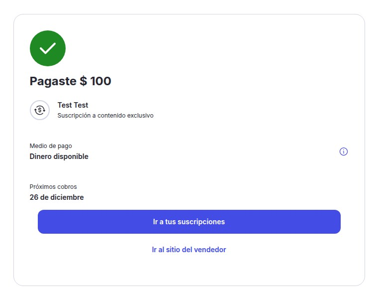

# Integración de Mercado Pago con Suscripciones

En este documento vamos a aprender a agregar suscripciones a nuestra aplicación utilizando [Suscripciones sin plan asociado con pago pendiente](https://www.mercadopago.com.ar/developers/es/docs/subscriptions/integration-configuration/subscription-no-associated-plan/pending-payments). Los usuarios van a poder ver contenido exclusivo siempre y cuando estén suscritos.

Podés preparar todo de dos formas:

- **A mano**: asegurate de haber [clonado el proyecto](../../configuracion/clonar-aplicacion/README.md), [creado una aplicación en Mercado Pago](../../configuracion/crear-aplicacion/README.md) (para producción), haber creado dos [cuentas de prueba](../../configuracion/cuentas-de-prueba/README.md) para Comprador y Vendedor, haber iniciado sesión en otro navegador con la cuenta de prueba de Vendedor y [crear una aplicación en Mercado Pago](../../configuracion/crear-aplicacion/README.md) (para desarrollo), haber [copiado las credenciales](../../configuracion/credenciales/README.md) de producción de la aplicación del Vendedor a tu archivo `.env.example` y renombrarlo a `.env.local`, haber [expuesto el puerto 3000 al exterior](../../configuracion/exponer-puerto/README.md) y haber [configurado un webhook](../../configuracion/webhook/README.md) para escuchar eventos de `Planes y Suscripciones`.
- **Con el MCP**: configurá el [MCP de Mercado Pago](../../configuracion/mcp/README.md) con los dos servidores y copiá este prompt en tu agente. Antes, [cloná el proyecto](../../configuracion/clonar-aplicacion/README.md) y [exponé el puerto 3000](../../configuracion/exponer-puerto/README.md). En el prompt, reemplazá `<URL pública>` por esa URL y `<tu usuario>` por tu usuario: los nombres de las aplicaciones no se pueden repetir.

```text
Usando el MCP de Mercado Pago, prepará este proyecto para desarrollo:
1. Con mercadopago-mcp-server, creá una aplicación de Suscripciones llamada <tu usuario>-next-mercadopago-suscripciones. Mostrame el resumen antes de crearla.
2. Cargale 10000 de saldo a la cuenta de prueba compradora que se creó con la aplicación y mostrame su usuario.
3. Copiá .env.example a .env.local. Completá MP_ACCESS_TOKEN con el access token de prueba y APP_URL con <URL pública>. No me muestres las credenciales y no agregues el archivo a git.
4. Con mercadopago-vendedor, configurá el webhook en <URL pública>/api/mercadopago para los eventos de Planes y suscripciones, en la aplicación de la vendedora de prueba cuyas credenciales usaste en el paso 3. Si mercadopago-vendedor no está autorizado, pedime que lo autorice con la cuenta vendedora de prueba y esperá.
```

El webhook se configura con `mercadopago-vendedor` porque las credenciales de prueba son de la aplicación de la vendedora de prueba: con tu cuenta principal, el MCP no puede modificarla. El usuario y la contraseña de la vendedora y de la compradora están en el [panel de desarrolladores](https://www.mercadopago.com.ar/developers/panel/app), en la aplicación, en `Cuentas de prueba`.

> [!IMPORTANT]
> Para suscribirte usá el email de la cuenta compradora de prueba: `test_user_<número>@testuser.com`, donde `<número>` es el de su usuario `TESTUSER<número>`. Con cualquier otro email, Mercado Pago responde `Both payer and collector must be real or test users`. Pagá con la sesión de la compradora, no con la de la vendedora.

## Indice

1. [Revisando nuestra aplicación](#revisando-nuestra-aplicación)
2. [Crear una suscripción](#crear-una-suscripción)
3. [Consultar el estado de la suscripción](#consultar-el-estado-de-la-suscripción)
4. [Recibir notificaciones](#recibir-notificaciones)
5. [Actualizar el estado de la suscripción](#actualizar-el-estado-de-la-suscripción)
6. [Probar la integración](#probar-la-integración)

## Revisando nuestra aplicación

En la página de inicio de nuestra aplicación (`/src/app/page.tsx`) se renderizan cosas diferentes dependiendo de si el usuario tiene o no una suscripción activa:
- Si no tiene una suscripción activa: Se renderiza un formulario para suscribirse, que al hacer submit, se redirecciona al usuario a Mercado Pago para que pueda pagar.
- Si el usuario tiene una suscripción activa: Se renderiza el contenido exclusivo para suscriptores.

```tsx
import {redirect} from "next/navigation";

import api from "@/api";

export default async function SuscripcionesPage() {
  // Verificamos si el usuario tiene una suscripción activa
  const active = await api.suscription.active();

  // Si está suscrito, mostramos el contenido exclusivo
  if (active) {
    return (
      <article className="grid gap-3">
        <h2>Contenido exclusivo</h2>
        <p>Gracias por suscribirte. Este contenido solo lo pueden ver los suscriptores.</p>
      </article>
    );
  }

  async function suscribe(formData: FormData) {
    "use server";

    const email = formData.get("email");
    const url = await api.suscription.create(email as string);

    redirect(url);
  }

  // Si no está suscrito, mostramos el formulario para suscribirse
  return (
    <form action={suscribe} className="sm:grid-cols-[1fr_auto]">
      <input name="email" placeholder="goncy@goncy.com" type="email" />
      <button className="justify-self-stretch" type="submit">
        Suscribirse
      </button>
    </form>
  );
}
```

> [!NOTE]
> En esta aplicación de ejemplo no tenemos usuarios ni base de datos: guardamos el ID de la suscripción en una cookie y le preguntamos a Mercado Pago su estado. Como leemos una cookie, la página se renderiza en cada request. El archivo `loading.tsx` la envuelve en un `<Suspense>` y muestra "Cargando..." mientras tanto, y el resto (el layout y ese fallback) sigue siendo estático. En una aplicación real vas a asociar la suscripción a tu usuario y manejar la lógica de autenticación normalmente.

## Crear una suscripción

Dentro de `/src/api.ts`, la función `create` en `suscription` se encarga de crear una suscripción sin plan asociado (con pago pendiente), guardar su ID en una cookie y devolver el init point (url de pago):

```ts
const api = {
  suscription: {
    async create(email: string) {
      // Creamos una suscripción sin plan asociado y con pago pendiente
      const suscription = await new PreApproval(mercadopago).create({
        body: {
          back_url: process.env.APP_URL!,
          reason: "Suscripción a contenido exclusivo",
          auto_recurring: {
            frequency: 1,
            frequency_type: "months",
            transaction_amount: 100,
            currency_id: "ARS",
          },
          payer_email: email,
          status: "pending",
        },
      });

      // Guardamos el id de la suscripción en una cookie para saber de quién es
      const cookieStore = await cookies();

      cookieStore.set("suscription", suscription.id!, {httpOnly: true});

      // Devolvemos el init point (url de pago) para que el usuario pueda pagar
      return suscription.init_point!;
    },
  },
};
```

Las suscripciones de pago pueden ser de 2 tipos:
- Suscripciones con plan asociado: Consta de 2 pasos, primero crear el plan, el cual estipula el título, monto, descripción, etc. Y el segundo paso es crear la suscripción. El problema es que para hacer esto, necesitamos un `card_token_id` el que generalmente obtenemos mediante Checkout Bricks o la Checkout API (la cual no vamos a implementar acá), queremos redirigir al usuario a Mercado Pago para que pueda pagar, similar a lo que haríamos con una preferencia de pago.
- Suscripciones sin plan asociado: Son suscripciones que se crean en el momento de pago, sin pasar por la creación de un plan. Al igual que las preferencias, nos devuelve un `init_point` para redirigir al usuario a Mercado Pago para completar el pago. Estas suscripciones pueden ser o de pago autorizado (necesitamos un `card_token_id`, lo cual no queremos ahora), o de pago pendiente para que el usuario complete el pago en Mercado Pago (justo lo que queremos).

Como te habrás dado cuenta, arriba estamos creando una suscripción sin plan asociado y de pago pendiente (status `pending`) y luego devolvemos el `init_point` y usamos esa URL para redirigir al usuario a Mercado Pago.

## Consultar el estado de la suscripción

Para saber si el usuario está suscrito, leemos el ID de la cookie y le preguntamos a Mercado Pago el estado de la suscripción. Cacheamos ese estado con un tag por suscripción, así no le preguntamos a Mercado Pago en cada visita:

```ts
const api = {
  suscription: {
    async active() {
      // Leemos el id de la suscripción de la cookie
      const cookieStore = await cookies();
      const id = cookieStore.get("suscription")?.value;

      // Si no hay suscripción, no está activa
      if (!id) return false;

      // Mercado Pago es nuestra base de datos: le preguntamos el estado de la suscripción
      const status = await api.suscription.status(id);

      return status === "authorized";
    },
    async status(id: string) {
      // Cacheamos el estado hasta que el webhook nos avise que cambió
      "use cache";

      cacheLife("max");
      cacheTag(`suscription-${id}`);

      // Obtenemos la suscripción y devolvemos su estado
      const suscription = await new PreApproval(mercadopago).get({id});

      return suscription.status;
    },
  },
};
```

## Recibir notificaciones

Tenemos un Route Handler (`src/app/api/mercadopago/route.ts`) definido en nuestra aplicación que se encarga de recibir las notificaciones de Mercado Pago.

```ts
import {revalidateTag} from "next/cache";

export async function POST(request: Request) {
  // Obtenemos el cuerpo de la petición que incluye el tipo de notificación
  const body: {data: {id: string}; type: string} = await request.json();

  // Solo nos interesan las notificaciones de suscripciones
  if (body.type === "subscription_preapproval") {
    // Invalidamos el estado de la suscripción para mostrar el contenido actualizado
    revalidateTag(`suscription-${body.data.id}`, {expire: 0});
  }

  // Respondemos con un estado 200 para indicarle que la notificación fue recibida
  return new Response(null, {status: 200});
}
```

> [!NOTE]
> Es importante siempre retornar un estado 200 para indicarle a Mercado Pago que la notificación fue recibida. Solo debemos retornar un estado que no sea 200 cuando hubo algún error por el cual queremos que Mercado Pago nos notifique nuevamente.

## Actualizar el estado de la suscripción

Este Route Handler va a recibir las notificaciones de suscripciones de Mercado Pago. Cada vez que una suscripción cambia (por ejemplo, cuando se autoriza), invalida el tag de esa suscripción (`api.suscription.status` usa `"use cache"` con ese tag) para que la próxima visita le pregunte a Mercado Pago el estado actualizado y muestre el contenido exclusivo.

En una aplicación real deberíamos verificar la concordancia de la clave secreta, devolver errores más descriptivos, actualizar la suscripción si el usuario se da de baja y más, pero por simplicidad y tiempo te voy a dejar esa tarea a vos, podés ver más [acá](https://www.mercadopago.com.ar/developers/es/docs/your-integrations/notifications/webhooks#configuracinatravsdetusintegraciones).

## Probar la integración

Ahora vamos a iniciar sesión con nuestra cuenta de prueba comprador, vamos a ir a la página de inicio de nuestra aplicación y en el formulario de suscripción, vamos a escribir el email de nuestro usuario de la cuenta de prueba comprador de Mercado Pago (podés obtener este email entrando a [este link](https://www.mercadopago.com.ar/hub-engine/hubs/my-profile) desde el navegador donde estás logeado con esa cuenta). Eso nos va a redirigir a Mercado Pago. Completemos el pago y deberíamos ver algo como esto:



> [!IMPORTANT]
> Es importante que uses el mail de la cuenta de prueba comprador de Mercado Pago, ya que si usas otro mail, posiblemente obtengas un error (poco descriptivo) y no puedas suscribirte.

Excelente, nuestra suscripción fue aprobada, la notificación fue recibida y si refrescamos la página deberíamos ver el contenido exclusivo ✨.

---

[Volver al inicio](../../README.md)
